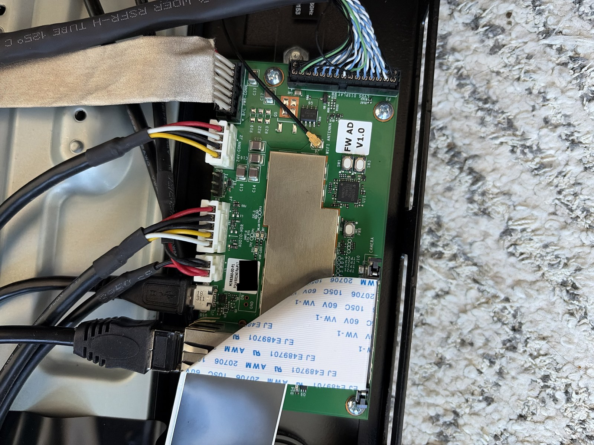
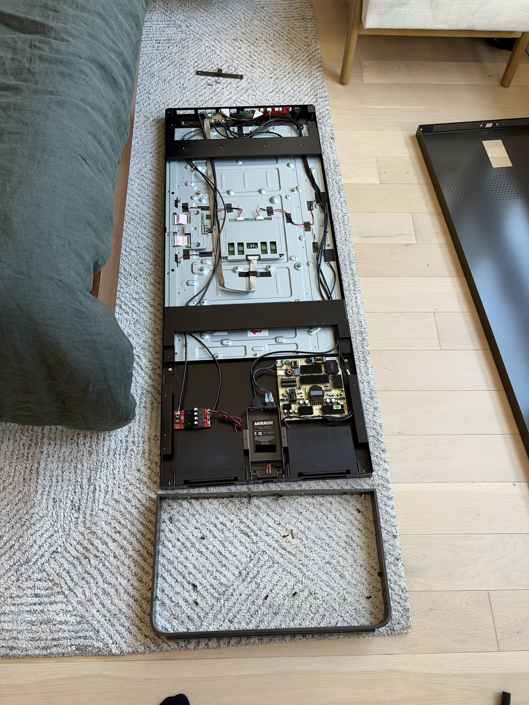
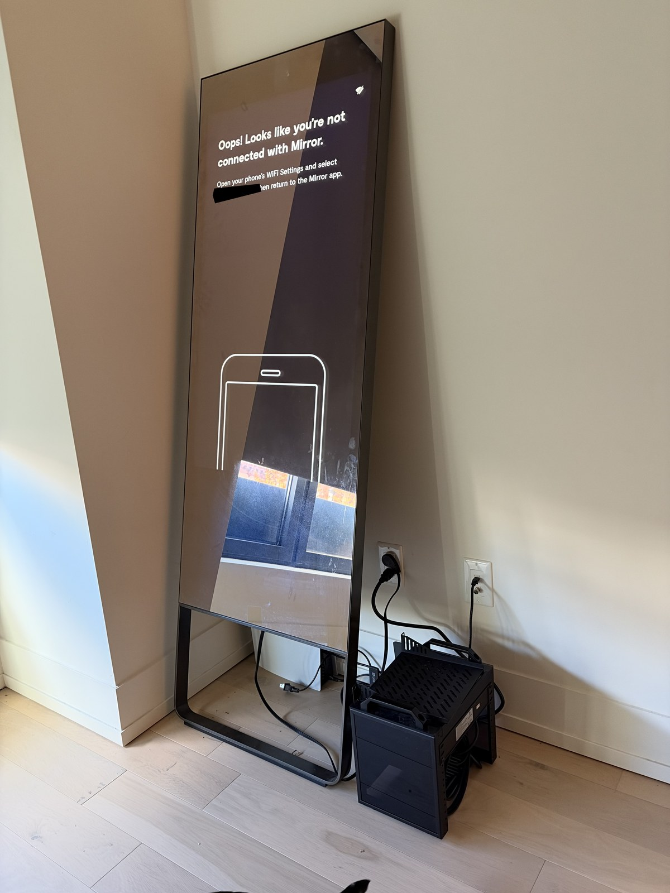

# Network ADB on a Lululemon Mirror that never shows up on USB (RevP17, stock 1.16.0)

This repo documents how one owner enabled **authorized ADB over a direct Ethernet
cable** on a Lululemon Studio Mirror (Model One) whose Qualcomm board **never
enumerates on USB in Android** — not even as an unauthorized device. The USB-only
ADB recipes that work on other units could not be checked on this one, because the
board stays dark on USB after boot. This one adds a TCP port to `adbd` so ADB is
reachable over the network instead.

It is a userdata-only method: it replaces the `userdata` partition with a fresh
ext4 image that carries the owner's ADB public key plus two Android properties. It
**does not touch** `system`, `boot`, `recovery`, or the bootloader, so re-flashing a
stock-shaped userdata image is the way back.

This is a data point and a procedure, not a product. It worked on **one** unit. Read
the warnings.

---

## Screenshots


*After the unlock, the Mirror runs your own Android launcher. Above: a minimal clock replacing the stock "set up" screen.*

## Photos

**The main board.** `SW3` (VOL-) and `SW1` (VOL+) are the two small buttons used to reach fastboot; the micro-USB (`J1`) and Ethernet are at the lower edge. Board ID `MIR63A0-OO-P1 / PCA#500240 / RevP17` is visible; the unit serial and QR are redacted.



**Internals / teardown.**



**Stock state before the work** (the "not connected" setup screen; hotspot name redacted).



## ⚠️ Warnings — read before anything

- **This wipes the Mirror's app data and settings.** Replacing `userdata` returns
  the unit to a first-run / "Let's set up your Mirror" state. There is no complete
  factory backup of a stock unit. This is not reversible to the exact prior data.
- **Stock setup may not complete again.** If Lululemon's servers refuse a fresh
  setup or pairing after the wipe (several owners suspect they do), a unit that works
  today as a stock Mirror may become unusable as a stock Mirror.
- **Opening the case exposes mains voltage.** The fastboot button (VOL-/SW3) is
  behind the rear service hatch on a mains-powered unit. Open only that hatch, keep
  hands away from the power-supply area, and plug mains power in **last**. If you are
  not comfortable around mains electronics, stop here.
- **No warranty. Your own device only.** This voids any warranty and may breach the
  terms you agreed to. Do this only on a unit you own, for your own repair or reuse.
  The authors take no responsibility for a bricked, bricked-further, or
  permanently-unusable unit.
- **Old data stays readable in free space.** The new filesystem skips free blocks, so
  the eMMC still holds old userdata bytes until Android overwrites them. A privacy
  note, not a brick risk.
- **Keep the Mirror off the internet during setup.** The wipe returns stock to its
  out-of-box setup, which has an update step. If the unit reaches the internet it may
  update itself to a newer firmware where this ADB method no longer works, closing
  the door for good. Use a direct cable that does not forward to the internet.

---

## Who this is for

- A **Lululemon Studio Mirror / Model One** with the Qualcomm MSM8916 board
  (`MIR63A0-00-P1` / `PCA#500240`).
- Specifically units that **do not enumerate on USB in Android** — the common
  USB-ADB recipes cannot be reached, so you need a network path.
- Owners who already know how to enter **fastboot** on the board and read it with
  `fastboot getvar`.

If your unit **does** show up on USB in Android, you probably do not need this. Use a
USB-ADB recipe (see Credits) and skip the TCP property.

### What is verified, and what is not

- **Verified on exactly one unit:** board `MIR63A0-00-P1 / PCA#500240` **RevP17**,
  stock `os_version 1.16.0`, build `IFC-6309-2.0-MIR/673`, `proto_version 0.0.12`.
  See [`docs/our-unit.md`](docs/our-unit.md).
- **Not verified:** any other board revision, any other firmware version, and whether
  stock setup can be completed again after the wipe. Firmware **1.2x and newer** is
  reported by other owners to break the `adb_keys` method entirely. The dividing line
  appears to be **firmware version, not board revision**.

---

## How it works (short version)

Stock `adbd` on this firmware does not listen on USB in a way this board exposes, and
does not listen on TCP by default. The fresh `userdata` image plants three things
that Android reads on first boot:

1. `/data/misc/adb/adb_keys` — the owner's ADB **public** key. With `ro.adb.secure=1`,
   a planted key is pre-authorized, so no on-glass "allow this computer?" dialog is
   needed (that dialog path is broken on this firmware anyway).
2. `/data/property/persist.sys.usb.config` = `adb` — the stock USB-ADB property, kept
   because it is part of the proven recipe on this firmware family.
3. `/data/property/persist.adb.tcp.port` = `5555` — tells `adbd` to open a **TCP**
   listener on port 5555 alongside (not instead of) USB. This is the part that makes
   the unit reachable over Ethernet.

You then connect the Mirror to your computer with a **direct Ethernet cable**, serve
it DHCP locally with **no internet forwarding**, and `adb connect <mirror-ip>:5555`.
The planted key authorizes automatically.

> On the test unit, `persist.sys.usb.config` alone (image #1) had **no visible
> effect** — USB stayed dark. The TCP property (image #2) is what made ADB reachable.
> If `adbd` were not running at all, the TCP port would also stay closed; on this unit
> it opened, which proves `adbd` runs.

---

## What you need

- A Mac or Linux host with:
  - **Android platform-tools** (`fastboot`, `adb`, and `mke2fs` + its `mke2fs.conf`).
    Tested with platform-tools **37.0.1**.
  - **GNU e2fsprogs** (`debugfs`, `e2fsck`, `dumpe2fs`). On macOS, Homebrew
    `e2fsprogs` 1.47.4.
  - **Python 3**.
- Your own **ADB key pair** (`adbkey` / `adbkey.pub`, normally in `~/.android/`). Only
  the **public** key goes into the image. **Never put a private key in a userdata
  image or a public report.**
- A **direct Ethernet cable** from the Mirror to your host (the test unit used a
  micro-USB-to-Ethernet adapter on the Mirror's data port).
- Physical access to the board's **fastboot button** (VOL-/SW3).

---

## Step-by-step

### 1. Read the target geometry (do not assume it)

Enter fastboot on the board (hold VOL-/SW3 while applying power), connect USB, then:

```sh
fastboot devices -l
fastboot -s <SERIAL> getvar product                 # expect: MSM8916
fastboot -s <SERIAL> getvar secure                  # expect: yes
fastboot -s <SERIAL> getvar partition-type:userdata # expect: ext4
fastboot -s <SERIAL> getvar partition-size:userdata # record this value
fastboot -s <SERIAL> getvar max-download-size       # record this value
```

The test unit reported `partition-size:userdata = 0x14cccd000` (5,583,458,304 bytes)
and `max-download-size = 0x10000000` (268,435,456 bytes). **If your partition size
differs, you must rebuild the image for your size** — the geometry is fixed into the
image.

### 2. Build the image

The image builder lives in an upstream project; this repo does **not** vendor it (see
Credits / Licensing). Point the build script at a checkout of that project at the
pinned commit:

```sh
scripts/build-userdata-tcp.sh \
  --builder-repo /path/to/lulu-mirror-software-only \
  --partition-size 0x14cccd000 \
  --filesystem-size 5583441920 \
  --public-key /path/to/your/adbkey.pub \
  --port 5555 \
  --out /path/to/output-dir
```

This produces `userdata-adb.sparse`. See [`scripts/README.md`](scripts/README.md) for
exactly what the script runs, and [`scripts/property.debugfs`](scripts/property.debugfs)
for the planted-property commands.

Build a **blank fallback** image too (same geometry, no planted files) with
`--blank`. Keep its path and SHA-256 handy for recovery.

### 3. Verify before you flash (hard gates — STOP if any fails)

Run [`scripts/preflash-gates.sh`](scripts/preflash-gates.sh) in **one session,
immediately before the write**, with the device on a **direct USB port (no hub)**:

```sh
scripts/preflash-gates.sh \
  --serial <SERIAL> \
  --expect-partition-size 0x14cccd000 \
  --image /path/to/output-dir/userdata-adb.sparse \
  --expect-sha256 <SHA256-OF-YOUR-BUILT-IMAGE>
```

It checks: exactly one device at `<SERIAL>`; `product=MSM8916`; `secure=yes`;
`partition-type:userdata=ext4`; `partition-size:userdata` equals your expected value
**exactly**; `max-download-size` parses to **≥ the image file size** (the real guard
against a partial/auto-split write); and the image SHA-256 matches. Any failure stops.

### 4. Flash — userdata only

Only after every gate passes:

```sh
caffeinate -i fastboot -s <SERIAL> -S 0 --verbose flash userdata \
  /path/to/output-dir/userdata-adb.sparse
```

- `caffeinate -i` (macOS) keeps the host awake for the transfer. On Linux, drop it.
- **Do not unplug or power-cycle** until both `Sending 'userdata' … OKAY` **and**
  `Writing 'userdata' … OKAY` print, followed by `Finished`.
- **No other partition is written.** No `erase`, no `format`, no `-w`, no `oem`, no
  `flashing`, no reboot in this step.
- On `-S 0`: in fastboot 37.0.1 this is the same as giving no `-S` (default limit is
  already 0 = "re-split only if larger than `max-download-size`"). It is kept because
  it is harmless and matches the precedent. The real guard is the max-download-size
  gate, not `-S 0`.

### 5. Reboot, kept offline

```sh
fastboot -s <SERIAL> reboot
```

**Do not give the Mirror internet.** Do not enter Wi-Fi credentials. Do not plug it
into your house network. Wait — **do not power-cycle for 15 minutes** while it boots
(first boot may encrypt the fresh userdata in place, which takes minutes; a power cut
mid-encryption corrupts userdata).

### 6. Bring up a direct DHCP link (no internet forwarding)

First prove your host will not forward to the internet, then serve DHCP on the direct
Ethernet interface. On macOS, [`scripts/mirror-dhcp-up.sh`](scripts/mirror-dhcp-up.sh)
does this; tear it down afterward with
[`scripts/mirror-dhcp-down.sh`](scripts/mirror-dhcp-down.sh):

```sh
# macOS, direct link on the given interface (e.g. en0):
scripts/mirror-dhcp-up.sh en0
# ... do the ADB work ...
scripts/mirror-dhcp-down.sh en0
```

The up-script aliases the interface to `10.77.0.1/24`, serves DHCP in
`10.77.0.50-.60`, and sets **no NAT and no default route to the internet**. Confirm
IP forwarding is off first (the script refuses to run if it is on):

```sh
sysctl net.inet.ip.forwarding    # must be 0
sysctl net.inet6.ip6.forwarding  # must be 0
```

### 7. Verify ADB over the network

Find the Mirror's IPv4 (macOS: `/var/db/dhcpd_leases`; expected `10.77.0.50`), then
scan the port and connect:

```sh
nc -z -w2 10.77.0.50 5555    # or: nmap -p5555 10.77.0.50
adb connect 10.77.0.50:5555
adb devices -l               # must show: 10.77.0.50:5555   device
adb -s 10.77.0.50:5555 shell getprop ro.build.fingerprint
```

Expect a `mirror/.../IFC-6309-2.0-MIR/...` fingerprint, `device` (not `unauthorized`,
not `offline`). Also useful: `getprop ro.crypto.state` (expect `unencrypted`),
`getprop persist.adb.tcp.port` (expect `5555`), `shell id` (expect `uid=2000(shell)`).

> **If the Homebrew `adb` server crashes on connect** (seen on macOS 27 with
> platform-tools 37.0.1 — a libunwind crash right after connect): retry
> `adb kill-server; adb start-server`, or use the pure-Python client in
> [`scripts/adb_connect_example.py`](scripts/adb_connect_example.py), which worked
> when the native client did not.

---

## If 5555 stays closed

A closed port after the flash means **TCP ADB is not reachable** — and nothing more.
You cannot tell these two causes apart from outside the device:

- `adbd` is running but the stock `build.prop` set `service.adb.tcp.port` (read first,
  e.g. to `-1`), overriding the planted `persist.adb.tcp.port`; **or**
- `adbd` is not running at all on this unit.

Both look identical. A closed 5555 is **not** proof the key method failed. The next
step would be a `system`-level change or a serial/UART console — a different, more
invasive approach not covered here. **Do not flash `system` to "fix" it** without a
separate plan: a `system` flash permanently removes the stock Lululemon software.

---

## Recovery

All failure modes here leave `aboot`/bootloader untouched, so **fastboot stays
reachable** (VOL-/SW3). None of these is a brick.

1. **A write fails mid-flash:** stop, keep the output, stay in fastboot, re-run the
   gates, correct the step. Do not touch other partitions.
2. **The image seems to be the cause** (boot-loops, mounts wrong): re-enter fastboot
   and flash the **blank fallback** image (same geometry, no planted files):
   ```sh
   caffeinate -i fastboot -s <SERIAL> -S 0 --verbose flash userdata \
     /path/to/output-dir/userdata-blank.sparse
   ```
   **Do not** use `fastboot erase` / `format:ext4` — host `format:ext4` creates ext4
   features this kernel rejects.
3. **It boots but ADB is unreachable or `unauthorized`:** record it and STOP. Do not
   touch `system`.
4. **First boot shows `ro.crypto.state=encrypted`:** the signed boot image may mark
   `/data` `forceencrypt`. If so, Android 6 encrypts the fresh userdata on first boot
   (minutes). Treat `encrypted` as "record and stop", and **do not power-cycle during
   a blank/logo screen in the first 15 minutes**.

---

## Credits and upstream

This method stands entirely on earlier community work. Please read and credit these:

- **`Onemoremichael/lulu-mirror-software-only`** — the userdata image builder
  (`tools/build-userdata.py`) and recovery docs. This repo references it at commit
  `efddcbdcaafeec087f16f009be6a13f77e0da3c1` rather than copying it.
  <https://github.com/Onemoremichael/lulu-mirror-software-only>
- **porcuswine's RevP18 owner report** — the original userdata-only `adb_keys` +
  `persist.sys.usb.config` recipe, and the full-partition sparse / zeroed-crypto-footer
  finalize step. Reported at
  <https://github.com/Onemoremichael/lulu-mirror-software-only/issues/10>.
- **`TimStewartJ/lululemon-mirror-repurpose` issue #5** — the owner thread that
  established firmware version (not board revision) as the dividing line for the
  `adb_keys` method, including the only prior working 1.16.0 report.
  <https://github.com/TimStewartJ/lululemon-mirror-repurpose/issues/5>

The TCP-port addition (`persist.adb.tcp.port`) and the "never enumerates on USB,
reach it over Ethernet" path are this repo's contribution. The underlying
`persist.adb.tcp.port` behavior is standard AOSP `adbd` (android-6.0.1_r81).

## Licensing

The code in **this** repo is MIT (see [`LICENSE`](LICENSE)). The upstream
`lulu-mirror-software-only` project is **referenced, not vendored** — at the time of
writing it ships no license file, so its code is not redistributed here. Clone it
yourself at the pinned commit. If you redistribute any upstream code, check its
license first.
